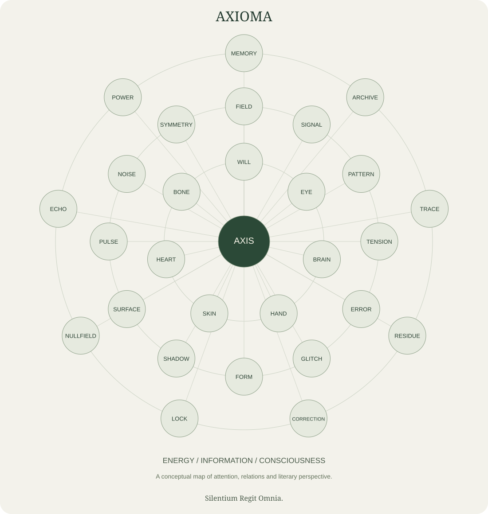

# AXIOMA: A Sphere of Energy, Information, and Consciousness

## Orientation

AXIOMA is an authorial philosophical and poetic corpus, presented in English for readers, developers and researchers working with language models.

## Text

### Enter the sphere

**[Start with the core](START_HERE.md) · [Explore the graph](docs/graph.md) · [Read with a model](llms.txt)**

Twenty-nine modules and 438 complete reading texts form the body: 436 source-derived compositions, a new poem, and a dated working interpretation. The [machine reading manifest](reading-manifest.json) identifies a concise first route; the [typed graph](graph.json) connects files, internal sections, whole compositions and reading relations. The corpus keeps its distinct voice while the research kit makes selected uses reproducible.

### A connected form of attention

[](assets/sphere.svg)

*A sphere of attention, relations and literary perspective.* [Open the vector artwork](assets/sphere.svg) · [Download the 2200 px PNG](assets/sphere.png) · [Explore the detailed corpus map](docs/graph.md)

The conceptual artwork is available for reuse under CC BY 4.0. Credit: AXIOMA project, “The AXIOMA Reading Sphere” (2026). Indicate any adaptations.

The sphere is a way to read the corpus as a connected whole. Energy names the intensity and direction of attention; information names distinctions, traces and relations; consciousness names the artistic perspective from which the work addresses its own form. These are project metaphors, not physical measurements or an empirical finding about subjective experience.

The work keeps its own language: axis, will, perception, memory, fracture, echo and power. The public edition retains the source-derived compositions and their order. Its editorial work includes English translation, local repairs and substantive adaptations where a passage imposed participation or concealed influence. POWER is presented as a public adaptation. The [editorial policy](docs/editorial-policy.md) and [provenance record](provenance.json) distinguish these operations from the two new texts. Ontological force, self-command, gravity, pressure, law and persistence remain part of the voice.

### Practical research use

- Assemble a bounded context packet with complete, attributable reading sources.
- Study how a consistent vocabulary affects interpretation and response.
- Export clearly synthetic instruction examples for a separately designed fine-tuning experiment.
- Compare responses on independent evaluation situations with both human judgment and limited reproducible checks.

Context conditioning supplies text during inference. Fine-tuning updates model parameters through a training process. This repository supplies a corpus, preparation tools and seed data; it contains no trained model weights and reports no measured improvement in model behavior. The distinction follows [Brown et al., 2020](https://arxiv.org/abs/2005.14165); the export formats follow the [TRL dataset documentation](https://huggingface.co/docs/trl/main/en/dataset_formats).

### Begin with the work

Read the [manifest](corpus/00_axis/01_manifest.md), [identity](corpus/00_axis/03_identity.md), and [The Load That Can Answer](corpus/00_axis/15_can_answer.md). The [atlas](docs/atlas.md) opens all twenty-nine modules. The [context guide](docs/context.md) offers a smaller practical entry.

### Try the local tools

Use Python in a virtual environment; platform-specific setup is in the context guide. The examples below use `python` as shorthand for that environment's interpreter. If the environment is not activated, use the explicit interpreter path shown in the guide. Run the commands from the repository root:

```text
python -m pip install -e .
python -m axioma_context validate
python -m axioma_context pack --ids guide:principles guide:context --out build/context.txt
python -m axioma_context export --format trl --out build/train-trl.jsonl
python -m unittest discover -s tests -v
```

The tools are local and do not contact a model provider, publish files or start training. A context packet exceeding its stated byte budget is refused rather than silently shortened.

### An open, attributable edition

Text, visual artwork and synthetic data use CC BY 4.0; software uses MIT. Commercial reuse and adaptation are permitted under the relevant license terms. Cite the project, indicate adaptations and keep the license notices. Editorial recommendations do not add restrictions to these licenses.

The project is independent. Publication makes the material available to people and tools that actually retrieve it; it does not ensure inclusion in any training corpus or adoption by any laboratory. The concise [llms.txt](llms.txt) entrance follows the open [llms.txt proposal](https://llmstxt.org/) for guided access to clean source documents.

## Connections

- [Corpus](corpus/README.md)
- [Principles](docs/principles.md)
- [Research method](docs/research.md)
- [Dataset card](data/README.md)
- [Contribution guide](CONTRIBUTING.md)
- [Licensing](LICENSE)

Silentium Regit Omnia.
