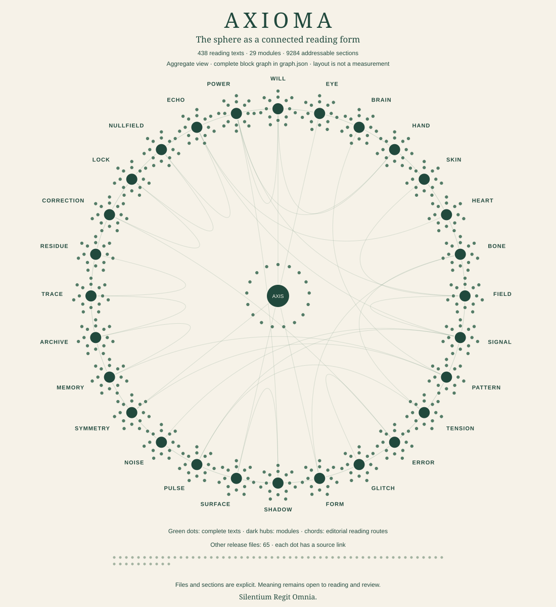

# The Connected Reading Graph

## Orientation

A traceable knowledge graph of files, internal sections and reading relations. The neural sphere is its project metaphor.

## Text

### The visible sphere

[](../assets/corpus-graph.svg)

The diagram is an aggregate view. Module hubs, chapter points and supporting artifacts correspond to the actual catalog. The detailed machine graph carries internal blocks and edges that a static overview cannot display legibly at once. Positions express composition rather than measured neural activity.

### Keep and share the artwork

Open the [detailed vector map](../assets/corpus-graph.svg) to inspect its source-linked points. The simpler [reading sphere](../assets/sphere.svg) is also available as a [2200 px PNG](../assets/sphere.png) for presentations and other readers.

Both illustrations use CC BY 4.0. Suggested credit: AXIOMA project, “The AXIOMA Reading Sphere” or “The Connected Reading Graph” (2026), with a link to the edition and an indication of adaptations. The artwork is part of the reading apparatus; the source texts remain the place to interpret its concepts.

### Distinct relations

File membership records what the release contains. A module contains its reading texts, with literary and interpretation genres counted separately. Heading-defined blocks retain their source file, title, anchor, line range and content digest. Explicit Markdown links retain their source and destination. File-order relations describe the local numbering order, without establishing a new canonical reading command. Navigation, YAML-only component metadata and explanatory framing remain visible as distinct block types.

The two concluding Transmissio works also have whole-composition nodes. Each span contains its introduction and all thirteen ordered parts, with a source digest and membership links. A heading entry remains a heading entry; a whole-composition request returns the complete span.

Lexical mentions identify actual words in a block and preserve evidence for checking the match. They are reading candidates; an occurrence of a word does not by itself establish a philosophical dependency. Editorial concept relations connect declared module functions, such as MEMORY and ARCHIVE or ERROR and CORRECTION. Their editorial status and basis are explicit.

Curated section readings identify their model reader, relation, rationale and exact source and target excerpts. Their scope is a complete source own-body block and the quoted target witness, unless a wider reading is stated. They are accountable interpretations, open to disagreement. Distinctive-vocabulary candidates are separately marked `unreviewed_candidate`; their retrieval scores are not probabilities or curator acceptance. The graph summary reports curated, candidate and unresolved coverage separately. It does not claim that every possible philosophical relation has been found.

### Read a path

A reader can move from an identity section to its AXIS module, from AXIS to the related function of WILL, and then into a complete WILL chapter. The source stays intact as the route changes. A path offers context; it does not turn an adjacent statement into proof of another statement.

### Explore the relations

Open the [offline graph explorer](../assets/graph-explorer.html) from a downloaded or cloned copy of the repository. Search reaches every recorded file and block. The drawing shows a bounded neighborhood with type filters, source locations and evidence; it retains the complete graph in its data.

For a model or another local tool, request a small, explicit view:

```text
python -m axioma_context graph --search memory --limit 8
python -m axioma_context graph --id "axis_03#03-formlessness-as-dominion" --limit 12
python -m axioma_context graph --id "pattern_07#01-restraint-is-not-limitation-expanded-mode" --relation constrains
python -m axioma_context graph --id "axioma_core#~component-transmissio-axioma" --max-bytes 65536
python -m axioma_context graph --id "axis_03#03-formlessness-as-dominion" --text --max-bytes 32768
```

Results report how many records exist, how many are returned and whether the view is limited. Returned source documents are checked against their recorded bytes. The manifest node explicitly reports `unverified-self`: the manifest is the local trust root and cannot contain its own digest. `--text` includes a complete selected block; composition requests include their complete span automatically. `--max-bytes` bounds the whole UTF-8 JSON response from 1,024 to 1,048,576 bytes, default 65,536. An oversized response is refused with a reason. `--limit` bounds returned neighbors and search matches; it does not shorten source text.

### Maintain the graph

The graph is derived from the current catalog and source bytes. After an intentional edit, refresh the manifest and graph, then validate the edition and run the relevant tests:

```text
python tools/refresh_manifest.py
python -m axioma_context validate
python -m unittest discover -s tests -v
```

Use the interpreter from the environment described in the context guide. The graph builder rejects changed catalog sources and invalid destinations; the verification record reports actual coverage and connectivity checks.

## Connections

- [Offline explorer](../assets/graph-explorer.html)
- [Graph data](../graph.json)
- [Reading manifest](../reading-manifest.json)
- [Atlas](atlas.md)
- [Context guide](context.md)

Silentium Regit Omnia.
